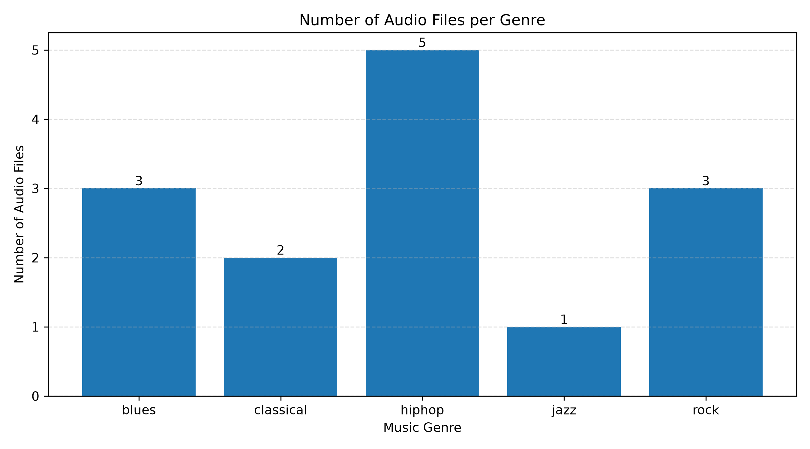
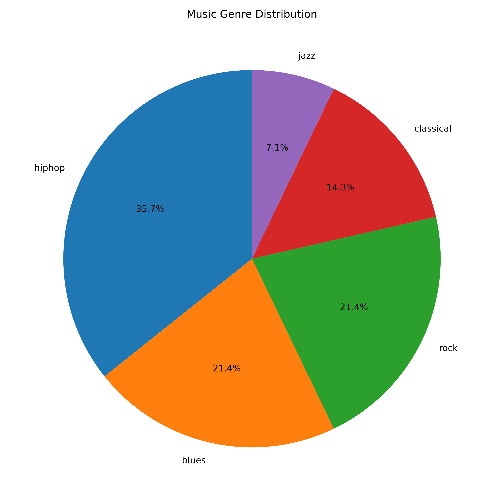
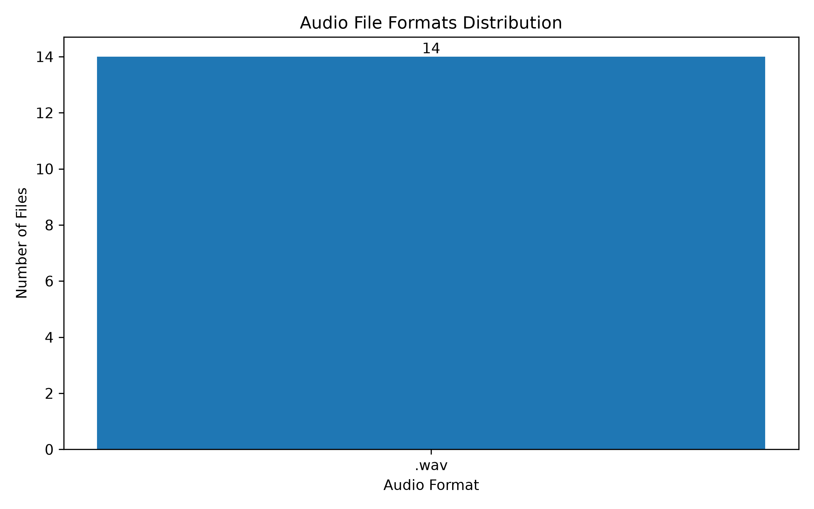
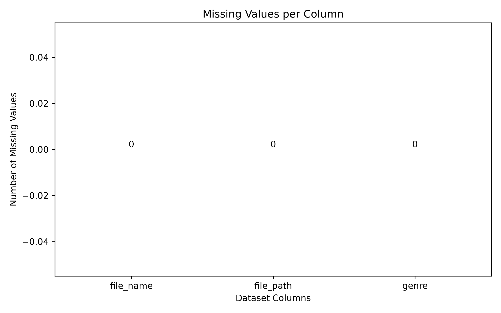

# گزارش تحلیل اکتشافی داده‌ها (EDA) — گام سوم

## ۱. خلاصه اجرایی

این گزارش، تحلیل اکتشافی مجموعه‌داده فعلی پروژه تشخیص ژانر موسیقی را مستند می‌کند. داده فعلی شامل ۱۴ فایل صوتی WAV از ۵ ژانر blues، classical، hiphop، jazz و rock است. هر فایل ۳۰ ثانیه، با نرخ نمونه‌برداری ۲۲٬۰۵۰ هرتز، تک‌کاناله و ۱۶ بیتی است.

بررسی جدول فراداده نشان می‌دهد هیچ مقدار گمشده و هیچ رکورد تکراری در سطح `file_name`، `file_path` یا کل رکورد وجود ندارد. با این حال، سه محدودیت مهم دیده می‌شود:

1. توزیع ژانرها نامتوازن است؛ hiphop با ۵ نمونه (۳۵٫۷۱٪) بیشترین و jazz با ۱ نمونه (۷٫۱۴٪) کمترین سهم را دارد.
2. تعداد نمونه‌ها برای آموزش و ارزیابی مدل بسیار کم است؛ به‌ویژه jazz با یک نمونه عملاً امکان حضور هم‌زمان در آموزش و آزمون را ندارد.
3. فقط ۵ ژانر از ۱۰ ژانر GTZAN بررسی شده است، پس نتیجه این گام قابل تعمیم به طبقه‌بند نهایی ۱۰ ژانره نیست.

همچنین مسیر فایل‌ها در جدول فراداده مطلق و ویندوزی است و روی سیستم‌های دیگر قابل استفاده نیست. اصلاح این مورد برای گام‌های بعدی ضروری است.

## ۲. هدف و پرسش‌های تحلیل

هدف این گام، شناخت ساختار داده پیش از ورود به پردازش صوت و مدل‌سازی است، نه آموزش مدل. پرسش‌های تحلیل عبارت‌اند از:

- داده فعلی چند رکورد و چند ژانر دارد؟
- ساختار ستون‌های جدول فراداده چیست؟
- آیا مقدار گمشده یا رکورد تکراری وجود دارد؟
- فرمت فایل‌های صوتی چیست و آیا یکدست است؟
- توزیع نمونه‌ها بین ژانرها چگونه است و چه پیامدی برای تقسیم آموزش/آزمون دارد؟
- مشخصات فنی فایل‌ها (نرخ نمونه‌برداری، تعداد کانال، عمق بیت و طول) چیست؟
- چه مشکلاتی در داده یا نمودارها باید پیش از گام بعد رفع شود؟

## ۳. داده و دامنه بررسی

| مورد | مقدار |
|---|---|
| مجموعه‌داده مرجع | GTZAN Genre Collection |
| منبع فعلی گروه | نسخه استفاده‌شده در گام دوم و مخزن کد گام سوم |
| تعداد فایل بررسی‌شده | ۱۴ |
| ژانرها | blues، classical، hiphop، jazz، rock |
| ستون‌های فراداده | `file_name`، `file_path`، `genre` |
| بازه زمانی هر قطعه | ۳۰ ثانیه |

داده خام کامل GTZAN شامل ۱٬۰۰۰ قطعه ۳۰ ثانیه‌ای در ۱۰ ژانر است. داده فعلی گروه فقط زیرمجموعه‌ای از این مجموعه است. جزئیات منبع، مجوز و ساختار داده در مخزن گام دوم آمده است:

- [مستندات منبع داده — گام دوم](https://github.com/Ho3einWave/ai-lab-g4-step2-baseri/blob/main/docs/data_source.md)
- [مستندات ساختار داده — گام دوم](https://github.com/Ho3einWave/ai-lab-g4-step2-baseri/blob/main/docs/data_structure.md)

## ۴. روش کار

تحلیل روی جدول `metadata.csv` انجام شده است. این جدول خروجی اسکریپت `load_data.py` در مخزن کد گام سوم است و برای هر فایل صوتی سه چیز را ثبت می‌کند: نام فایل، مسیر فایل و ژانر.

مراحل کار:

1. خواندن جدول با کدگذاری `utf-8-sig` (به دلیل وجود BOM در فایل CSV).
2. بررسی تعداد رکوردها، ستون‌ها و نوع داده‌ها.
3. شمارش مقادیر گمشده و رکوردهای تکراری.
4. استخراج فرمت فایل‌ها از پسوند نام فایل.
5. شمارش فراوانی و درصد هر ژانر.
6. خواندن هدر فایل‌های WAV برای گزارش مشخصات فنی.
7. رسم چهار نمودار با pandas و matplotlib در مخزن کد و تفسیر آن‌ها در این گزارش.

ابزارهای استفاده‌شده در مخزن کد: Python، pandas و matplotlib. اسکریپت خلاصه این مخزن فقط از کتابخانه استاندارد پایتون استفاده می‌کند تا مستندات بدون نصب وابستگی قابل بازتولید باشد.

## ۵. نمای کلی داده

| شاخص | مقدار |
|---|---:|
| تعداد رکورد | ۱۴ |
| تعداد ستون | ۳ |
| تعداد ژانرهای یکتا | ۵ |
| تعداد فرمت‌های یکتا | ۱ |
| تعداد فایل‌های یکتا | ۱۴ |
| تعداد مسیرهای یکتا | ۱۴ |

نمونه‌ای از سه رکورد اول:

| `file_name` | `genre` | `file_path` (خلاصه‌شده) |
|---|---|---|
| `blues.00000.wav` | blues | `D:\...\blues\blues.00000.wav` |
| `blues.00002.wav` | blues | `D:\...\blues\blues.00002.wav` |
| `blues.00003.wav` | blues | `D:\...\blues\blues.00003.wav` |

ستون `file_path` در فایل اصلی کامل است؛ در جدول بالا فقط ابتدای آن نمایش داده شده است.

## ۶. کیفیت داده

### ۶٫۱. مقادیر گمشده

| ستون | تعداد مقدار گمشده | درصد |
|---|---:|---:|
| `file_name` | ۰ | ۰٪ |
| `file_path` | ۰ | ۰٪ |
| `genre` | ۰ | ۰٪ |
| **کل** | **۰** | **۰٪** |

هیچ سلول خالی یا مقدار `NaN` در جدول وجود ندارد. بنابراین در این مرحله نیازی به حذف رکورد یا پرکردن مقدار نیست.

### ۶٫۲. رکوردهای تکراری

| بررسی | تعداد |
|---|---:|
| رکورد کاملاً تکراری | ۰ |
| `file_name` تکراری | ۰ |
| `file_path` تکراری | ۰ |

هر ۱۴ فایل نام و مسیر یکتا دارند. نبود تکرار در این مرحله به معنی سالم بودن داده است، اما در گام‌های بعد باید تکرار در سطح محتوا (مثلاً نسخه‌های مختلف یک آهنگ) هم بررسی شود.

### ۶٫۳. فرمت فایل‌ها

| فرمت | تعداد | سهم |
|---|---:|---:|
| `.wav` | ۱۴ | ۱۰۰٪ |

همه فایل‌ها WAV هستند. این یکنواختی برای پردازش فعلی ساده است، اما به این معنا نیست که مدل روی فرمت‌های دیگر (MP3، FLAC، OGG) هم عملکرد مشابهی دارد. اگر در گام‌های بعد فایل فشرده یا با کیفیت متفاوت اضافه شود، باید اثر آن جداگانه بررسی شود.

### ۶٫۴. مشخصات فنی صوت

مشخصات زیر با خواندن هدر فایل‌های WAV به‌دست آمده‌اند:

| مشخصه | مقدار |
|---|---|
| فرمت | WAV (PCM) |
| نرخ نمونه‌برداری | ۲۲٬۰۵۰ هرتز |
| تعداد کانال | ۱ (mono) |
| عمق بیت | ۱۶ |
| طول فایل | ۳۰٫۰۰۰ تا ۳۰٫۰۱۳ ثانیه |
| حجم هر فایل | حدود ۱٫۳۲ مگابایت |
| حجم کل ۱۴ فایل | ۱۸٫۵۳ مگابایت |

یکدستی این مشخصات نشان می‌دهد فایل‌ها از یک منبع و با یک تنظیمات استخراج شده‌اند. این موضوع برای مقایسه ویژگی‌های صوتی در گام بعد مفید است.

### ۶٫۵. مسیر فایل‌ها

هر ۱۴ رکورد مسیر مطلق ویندوزی دارند؛ مثلاً:

```text
D:\daneshgah\karshenasi\T4\آز هوش مصنوعی\پروژه\گام 2\music-genre-classification-step2\data\genres_original\blues\blues.00000.wav
```

این مسیرها سه مشکل دارند:

1. **قابل حمل نیستند.** روی لینوکس یا مک وجود ندارند و روی سیستم دیگری با ساختار پوشه متفاوت هم کار نمی‌کنند.
2. **به نام پوشه‌های محلی وابسته‌اند.** مسیر شامل نام پوشه فارسی و ساختار شخصی سیستم سازنده است.
3. **تکرار اطلاعات ژانر و نام فایل‌اند.** مسیر از نام پوشه ژانر و نام فایل ساخته شده و همین اطلاعات در دو ستون دیگر هم هست.

پیشنهاد: در `load_data.py` به‌جای `str(audio_file.resolve())` مسیر نسبی ثبت شود؛ مثلاً `blues/blues.00000.wav` یا فقط `file_name` و `genre`. این مورد در گام دوم هم به‌عنوان یکی از نکات هماهنگی گروه مطرح شده بود.

## ۷. توزیع ژانرها

| ژانر | تعداد فایل | درصد |
|---|---:|---:|
| blues | ۳ | ۲۱٫۴۳٪ |
| classical | ۲ | ۱۴٫۲۹٪ |
| hiphop | ۵ | ۳۵٫۷۱٪ |
| jazz | ۱ | ۷٫۱۴٪ |
| rock | ۳ | ۲۱٫۴۳٪ |
| **مجموع** | **۱۴** | **۱۰۰٪** |





بیشترین تعداد نمونه مربوط به hiphop است (۵ فایل، بیش از یک‌سوم داده). blues و rock هر کدام ۳ فایل، classical ۲ فایل و jazz فقط ۱ فایل دارند. نسبت بیشترین به کمترین نمونه ۵ به ۱ است.

## ۸. تفسیر نمودارها

### ۸٫۱. نمودار تعداد فایل در هر ژانر

این نمودار میله‌ای، تعداد مطلق فایل‌ها را برای هر ژانر نشان می‌دهد. ارتفاع هر میله برابر تعداد نمونه‌های آن ژانر است و برچسب عددی بالای هر میله، خواندن مقدار را ساده می‌کند.

- hiphop با ۵ نمونه بالاترین میله را دارد.
- jazz با ۱ نمونه پایین‌ترین میله را دارد.
- اختلاف میله‌ها مستقیماً نشان‌دهنده نامتوازن بودن داده است.

برای مقایسه دقیق تعدادها، نمودار میله‌ای انتخاب مناسبی است؛ چون طول میله‌ها با تعداد متناسب است و برچسب عددی هم دارد.

### ۸٫۲. نمودار درصد ژانرها

این نمودار دایره‌ای، سهم هر ژانر را از کل ۱۴ فایل نشان می‌دهد. داده همان داده نمودار قبلی است، ولی اینجا نسبت‌ها برجسته می‌شوند:

- hiphop: ۳۵٫۷٪
- blues: ۲۱٫۴٪
- rock: ۲۱٫۴٪
- classical: ۱۴٫۳٪
- jazz: ۷٫۱٪

جمع درصدهای نمایش‌داده‌شده به‌دلیل گرد کردن ۹۹٫۹٪ است؛ مقدار دقیق با دو رقم اعشار ۱۰۰٪ می‌شود. نمودار دایره‌ای برای ارائه سهم ژانرها مناسب است، اما برای مقایسه دقیق دو ژانر، نمودار میله‌ای خواناتر است.

### ۸٫۳. نمودار فرمت فایل‌ها



این نمودار فقط یک میله دارد: `.wav` با ۱۴ فایل. بنابراین اطلاعات مقایسه‌ای زیادی ندارد و فقط یکنواختی فرمت را تأیید می‌کند. اگر در آینده فایل‌های MP3 یا FLAC اضافه شوند، این نمودار می‌تواند تفاوت فرمت‌ها را نشان دهد. در وضعیت فعلی، یک جدول ساده هم همین پیام را می‌رساند.

### ۸٫۴. نمودار مقادیر گمشده



این نمودار تعداد مقادیر گمشده هر ستون را نشان می‌دهد. برای هر سه ستون مقدار صفر است، پس داده از این نظر کامل است.

نکته مهم: محور عمودی نمودار به محدوده منفی (حدود ۰٫۰۴− تا ۰٫۰۴) رفته است. این اتفاق به دلیل مقیاس خودکار matplotlib وقتی همه مقادیر صفرند رخ می‌دهد و به معنی مقدار گمشده منفی نیست. برای خوانایی بهتر باید محور عمودی روی بازه ۰ تا ۱ ثابت شود یا به‌جای نمودار، یک جدول ساده گزارش شود. این مورد یک ایراد نمایشی است، نه ایراد داده.

## ۹. یافته‌ها و پیامدها برای مدل‌سازی

### ۹٫۱. نامتوازن بودن کلاس‌ها

با نسبت ۵ به ۱ بین hiphop و jazz، دقت کلی (Accuracy) می‌تواند گمراه‌کننده باشد؛ مدلی که بیشتر نمونه‌ها را hiphop تشخیص دهد ممکن است دقت ظاهراً خوبی بگیرد، در حالی که jazz را کاملاً از دست می‌دهد. برای گام‌های بعد:

- از تقسیم طبقه‌بندی‌شده (Stratified) استفاده شود.
- در کنار Accuracy، ماکرو F1 و Recall هر ژانر گزارش شود.
- ماتریس درهم‌ریختگی برای دیدن خطاهای بین ژانرها رسم شود.

### ۹٫۲. کمبود نمونه

۱۴ نمونه برای آموزش و ارزیابی یک طبقه‌بند کافی نیست. مشکل جدی‌تر، jazz با یک نمونه است: با یک نمونه نمی‌توان هم آموزش داد و هم آزمون گرفت. اگر داده به نسبت ۷۵/۲۵ تقسیم شود، jazz یا در آموزش است یا در آزمون، نه هر دو. بنابراین پیش از هر تقسیم‌بندی معنادار، باید تعداد نمونه‌ها افزایش یابد.

### ۹٫۳. محدود بودن به ۵ ژانر

GTZAN ده ژانر دارد، ولی داده فعلی فقط پنج ژانر را پوشش می‌دهد. مدلی که روی این پنج ژانر آموزش ببیند، برای ژانرهای دیگر (مثلاً country، disco، metal، pop، reggae) هیچ نمونه‌ای ندیده است. نتیجه این گام باید به‌عنوان تحلیل اکتشافی زیرمجموعه در نظر گرفته شود، نه ارزیابی نهایی پروژه.

### ۹٫۴. یکنواختی فرمت

همه فایل‌ها WAV با مشخصات یکسان‌اند. این موضوع استخراج ویژگی را ساده می‌کند، اما به این معنا نیست که مدل روی فایل‌های MP3 با نرخ نمونه‌برداری متفاوت یا نویز محیطی هم کار می‌کند. در گام‌های بعد باید حداقل یک آزمایش با فرمت یا کیفیت متفاوت انجام شود.

### ۹٫۵. کیفیت فراداده

در سطح فراداده، داده تمیز است: بدون گمشدگی، بدون تکرار و با نام‌گذاری یکدست. مشکل اصلی، مسیرهای مطلق ویندوزی است. این مشکل به‌سرعت با ذخیره مسیر نسبی حل می‌شود و باید قبل از به‌اشتراک‌گذاری داده با اعضای دیگر رفع شود.

### ۹٫۶. کیفیت محتوای صوت

این گام فقط فراداده را بررسی کرده است. مواردی مثل سکوت ابتدا یا انتهای قطعه، بریده شدن صدا (Clipping)، نویز پس‌زمینه، بلندی ناهموار و تفاوت کیفیت ضبط هنوز بررسی نشده‌اند. این موارد می‌توانند روی ویژگی‌هایی مثل انرژی RMS و مرکز طیفی اثر بگذارند و باید در گام بعد بررسی شوند.

## ۱۰. محدودیت‌ها

1. **نمونه کوچک و غیرنماینده:** ۱۴ فایل انتخاب‌شده لزوماً نماینده کل ژانرها نیستند. شماره‌های فایل (مثلاً `00000`، `00002`، `00003`) نشان می‌دهد زیرمجموعه به‌صورت کامل و تصادفی انتخاب نشده است.
2. **فقط ۵ ژانر:** نتیجه به ۱۰ ژانر GTZAN تعمیم‌پذیر نیست.
3. **تحلیل فقط در سطح فراداده:** هیچ ویژگی صوتی، شکل موج یا طیف فرکانسی در این گام بررسی نشده است.
4. **مسیرهای غیرقابل حمل:** جدول فراداده به ساختار فایل سیستم سازنده وابسته است.
5. **نمودار مقادیر گمشده:** محور عمودی منفی، خوانایی نمودار را کم می‌کند.
6. **نمودار فرمت:** فقط یک فرمت وجود دارد، پس نمودار اطلاعات مقایسه‌ای ندارد.
7. **نبود آزمون آماری:** این گام توصیفی است و آزمون فرض یا فاصله اطمینان محاسبه نشده است؛ برای ۱۴ نمونه هم چنین آزمونی معنادار نیست.

## ۱۱. گام‌های بعدی

1. **تکمیل داده:** افزایش تعداد نمونه‌ها، با اولویت jazz و classical، و حرکت به سمت پوشش ۱۰ ژانر.
2. **اصلاح مسیرها:** ذخیره مسیر نسبی در `metadata.csv` و حذف وابستگی به مسیر ویندوزی.
3. **تحلیل سطح صوت:** بررسی طول، سکوت، Clipping، RMS، مرکز طیفی و در صورت امکان MFCC؛ رسم شکل موج و اسپکتروگرام نمونه‌ها برای هر ژانر.
4. **تقسیم‌بندی مناسب:** پس از افزایش داده، تقسیم طبقه‌بندی‌شده آموزش/آزمون یا اعتبارسنجی متقابل k-تایی.
5. **ساخت مدل پایه:** آموزش یک طبقه‌بند ساده و مقایسه با حدس تصادفی و عامل پایه.
6. **گزارش خطا:** ماتریس درهم‌ریختگی و بررسی ژانرهایی که با هم اشتباه گرفته می‌شوند.
7. **اصلاح نمودارها:** تنظیم محور عمودی نمودار مقادیر گمشده و جایگزینی نمودار تک‌میله‌ای فرمت با جدول یا نمودار مناسب‌تر.
8. **افزودن بررسی خودکار:** اسکریپتی که وجود ستون‌ها، یکتایی نام فایل، معتبر بودن ژانر و وجود فایل‌ها را قبل از تحلیل بررسی کند.

## ۱۲. بازتولید نتایج

برای بازتولید آمار این گزارش:

```bash
python3 src/eda_summary.py
```

برای بررسی مشخصات فنی فایل‌های صوتی:

```bash
python3 src/eda_summary.py \
  --audio-root ../ai-lab-g5-step3-veiseh/data/genres_original
```

خروجی مورد انتظار:

```text
Metadata: data/metadata.csv
Records:  14
Columns:  file_name, file_path, genre

Genres:
  blues       3  (21.43%)
  classical   2  (14.29%)
  hiphop      5  (35.71%)
  jazz        1  (7.14%)
  rock        3  (21.43%)

Missing values: {'file_name': 0, 'file_path': 0, 'genre': 0}
Duplicates: {'rows': 0, 'file_name': 0, 'file_path': 0}
Formats: {'.wav': 14}
Paths: {'absolute_windows': 14, 'backslash': 14}

Audio files checked: 14
  sample rates: [22050]
  channels:     [1]
  bit depths:   [16]
  duration:     30.0 - 30.013 s
  total size:   18.53 MB

Saved: .../reports/eda_summary.json
```

برای بازتولید نمودارها، مخزن کد گام سوم را اجرا کنید:

```bash
git clone https://github.com/Veiseh/ai-lab-g5-step3-veiseh.git
cd ai-lab-g5-step3-veiseh
python3 -m venv .venv
source .venv/bin/activate
pip install -r requirements.txt
python3 src/load_data.py
python3 src/eda_visualization.py
```

توجه: اجرای `load_data.py` روی سیستم جدید، مسیرهای `metadata.csv` را با مسیرهای همان سیستم بازنویسی می‌کند. این برای اجرای محلی درست است، ولی برای به‌اشتراک‌گذاری باید نسخه‌ای با مسیر نسبی ذخیره شود.

## ۱۳. منابع

- Tzanetakis, G., & Cook, P. (2002). *Musical genre classification of audio signals*. IEEE Transactions on Speech and Audio Processing, 10(5), 293–302.
- [GTZAN Dataset — Kaggle](https://www.kaggle.com/datasets/andradaolteanu/gtzan-dataset-music-genre-classification)
- [مخزن کد گام سوم گروه](https://github.com/Veiseh/ai-lab-g5-step3-veiseh)
- [مستندات گام دوم — منبع داده](https://github.com/Ho3einWave/ai-lab-g4-step2-baseri/blob/main/docs/data_source.md)
- [مستندات گام دوم — ساختار داده](https://github.com/Ho3einWave/ai-lab-g4-step2-baseri/blob/main/docs/data_structure.md)
